# QuizHub – Database Entity-Relationship (ER) Diagram

The QuizHub platform database consists of 21 normalized tables designed for high performance, transaction safety, and referential integrity in MySQL.

```mermaid
erDiagram
    users ||--o| student_profiles : has
    users ||--o| teacher_profiles : has
    users ||--o{ quizzes : creates
    users ||--o{ session_participants : joins
    users ||--o{ submitted_answers : submits
    users ||--o{ game_results : achieves
    users ||--o{ tournament_participants : registers
    users ||--o{ team_members : belongs_to
    users ||--o{ user_achievements : unlocks
    users ||--o{ notifications : receives
    users ||--o{ activity_logs : triggers
    users ||--o{ reports : files
    
    quizzes ||--|{ questions : contains
    questions ||--|{ answer_options : has
    quizzes ||--o{ quiz_sessions : hosts
    
    quiz_sessions ||--o{ session_participants : contains
    quiz_sessions ||--o{ submitted_answers : logs
    quiz_sessions ||--o{ game_results : produces
    
    tournaments ||--o{ tournament_participants : enrolls
    tournaments ||--o{ quiz_sessions : schedules
    
    teams ||--|{ team_members : groups
    
    achievements ||--o{ user_achievements : granted_to

    users {
        int id PK
        string email UK
        string password_hash
        string full_name
        enum role "student, teacher, admin"
        string avatar_url
        boolean is_active
        timestamp created_at
        timestamp updated_at
    }

    student_profiles {
        int id PK
        int user_id FK
        int xp
        int level
        int streak
        int total_quizzes_played
        int total_wins
        float accuracy_rate
    }

    teacher_profiles {
        int id PK
        int user_id FK
        string school_or_organization
        string subject_specialization
        string bio
        boolean verified
    }

    quizzes {
        int id PK
        int creator_id FK
        string title
        text description
        string category
        enum difficulty "easy, medium, hard"
        string cover_image
        int time_limit_per_question
        boolean is_published
        boolean is_public
        boolean randomize_questions
        boolean randomize_options
        timestamp created_at
    }

    questions {
        int id PK
        int quiz_id FK
        text question_text
        enum question_type "multiple_choice, true_false, multi_select"
        int time_limit
        int points
        string image_url
        int order_num
    }

    answer_options {
        int id PK
        int question_id FK
        string option_text
        boolean is_correct
        int order_num
    }

    quiz_sessions {
        int id PK
        string pin UK
        int quiz_id FK
        int host_id FK
        enum status "lobby, active, question_active, showing_result, completed, cancelled"
        int current_question_index
        timestamp current_question_start_time
        enum session_type "live_multiplayer, duel_1v1, tournament"
        timestamp created_at
    }

    session_participants {
        int id PK
        int session_id FK
        int user_id FK
        string nickname
        int score
        int streak
        int rank
        boolean is_connected
        timestamp joined_at
    }

    submitted_answers {
        int id PK
        int session_id FK
        int participant_id FK
        int question_id FK
        json selected_option_ids
        boolean is_correct
        int points_awarded
        float response_time_seconds
        timestamp submitted_at
    }

    game_results {
        int id PK
        int session_id FK
        int user_id FK
        int final_score
        int final_rank
        int correct_count
        int incorrect_count
        float average_speed
        int xp_earned
        timestamp created_at
    }

    tournaments {
        int id PK
        string title
        text description
        string category
        enum status "upcoming, registration_open, live, completed, cancelled"
        int max_participants
        int creator_id FK
        int quiz_id FK
        timestamp start_date
        timestamp end_date
        timestamp registration_deadline
    }

    tournament_participants {
        int id PK
        int tournament_id FK
        int user_id FK
        int final_rank
        int score
        timestamp registered_at
    }

    teams {
        int id PK
        string name
        int captain_id FK
        string avatar_url
        timestamp created_at
    }

    team_members {
        int id PK
        int team_id FK
        int user_id FK
        enum role "captain, member"
        timestamp joined_at
    }

    friendships {
        int id PK
        int requester_id FK
        int addressee_id FK
        enum status "pending, accepted, blocked"
        timestamp created_at
    }

    challenges {
        int id PK
        int challenger_id FK
        int challenged_id FK
        int quiz_id FK
        int session_id FK
        enum status "pending, accepted, declined, completed"
        timestamp created_at
    }

    achievements {
        int id PK
        string code UK
        string title
        string description
        string badge_icon
        int xp_reward
    }

    user_achievements {
        int id PK
        int user_id FK
        int achievement_id FK
        timestamp unlocked_at
    }

    notifications {
        int id PK
        int user_id FK
        string title
        text message
        string link
        boolean is_read
        timestamp created_at
    }

    reports {
        int id PK
        int reporter_id FK
        enum target_type "quiz, question, user"
        int target_id
        string reason
        enum status "pending, reviewed, dismissed, actioned"
        timestamp created_at
    }

    activity_logs {
        int id PK
        int user_id FK
        string action
        string ip_address
        json metadata
        timestamp created_at
    }
```

