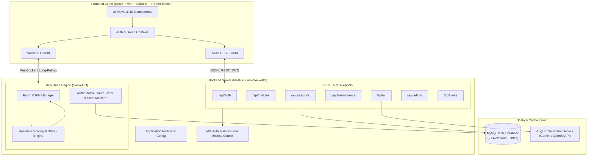

# QuizHub – System Architecture Documentation

## 1. System Overview
**QuizHub** is a high-performance, real-time online quiz competition platform designed with an esports & gaming aesthetic. It integrates interactive learning, real-time multiplayer competition with low-latency WebSockets, automated scoring with streak & speed bonuses, tournament management, 1v1 duels, AI quiz generation, and administrative analytics.



---

## 2. Technology Choices & Design Principles

### Frontend
- **React 18 & Vite**: Fast bundling, modern reactive state management.
- **Tailwind CSS**: Dark esports theme (Deep Navy `#0B0F19`, Electric Blue `#00D2FF`, Vivid Violet `#7928CA`, Cyberpunk Neon `#00F5A0`, `#FF007A`).
- **Framer Motion**: Smooth page transitions, animated countdowns, score ticker animations, interactive hover/active states.
- **Lucide React**: Clean, modern icons across navigation and dashboards.
- **Recharts**: Performance analytics, accuracy curves, and admin metrics.
- **Canvas-Confetti / Lucide 3D cues**: Winner podium celebration.

### Backend
- **Python 3 / Flask**: Modular Blueprints, clear separation of concerns.
- **Flask-SocketIO**: Authoritative real-time game coordination.
- **Flask-JWT-Extended**: Stateless token authentication with role-based access tokens (Student, Teacher, Admin).
- **Flask-SQLAlchemy & PyMySQL**: ORM abstraction with connection pooling, transactions, and MySQL/MariaDB standard compatibility.
- **Flask-CORS**: Secure cross-origin resource sharing between client and API server.

### Real-Time Authoritative Game Flow
1. **Never trust client state**: The server computes timers, validates answers, determines streaks, and assigns points.
2. **Hidden correct answers**: Question options sent to players lack the `is_correct` flag until the question timer ends.
3. **Double-submission guard**: In-memory and transactional checks prevent a participant from answering more than once per question.
4. **Resilient Reconnection**: Players can rejoin an ongoing competition using their user ID and session token.

---

## 3. Directory Layout
```
quizhub/
├── frontend/
│   ├── public/
│   ├── src/
│   │   ├── assets/
│   │   ├── components/      # Glassmorphism cards, modals, timers, badges
│   │   ├── contexts/        # AuthContext, GameContext, ThemeContext
│   │   ├── hooks/           # useSocket, useTimer, useSound
│   │   ├── layouts/         # MainLayout, DashboardLayout, GameLayout
│   │   ├── pages/           # Landing, Auth, Student, Teacher, Host, Play, Admin, etc.
│   │   ├── services/        # api.js, socket.js, authService.js
│   │   ├── styles/          # Tailwind directives, animations
│   │   ├── utils/           # Formatters, sound effects, helpers
│   │   ├── App.jsx
│   │   └── main.jsx
│   ├── index.html
│   ├── package.json
│   ├── tailwind.config.js
│   └── vite.config.js
├── backend/
│   ├── app/
│   │   ├── models/          # 21 Normalized SQLAlchemy models
│   │   ├── routes/          # REST endpoints split into blueprints
│   │   ├── services/        # Scoring, AI generation, Game session manager
│   │   ├── sockets/         # Socket.IO event handlers and rooms
│   │   ├── middleware/      # JWT RBAC decorators, error handlers
│   │   ├── utils/           # PIN generator, validators
│   │   ├── config.py        # Environment-driven settings
│   │   ├── extensions.py    # db, jwt, socketio, cors, migrate instances
│   │   └── __init__.py      # create_app() factory
│   ├── migrations/
│   ├── tests/
│   ├── requirements.txt
│   └── run.py
├── database/
│   ├── schema.sql           # Complete MySQL DDL definitions
│   ├── seed.py              # Initial admin, teacher, student, and demo quizzes
│   └── er_diagram.md        # Database relationship mapping
├── docs/
│   ├── architecture.md
│   ├── api_documentation.md
│   └── setup_guide.md
├── .env.example
├── .gitignore
└── README.md
```

